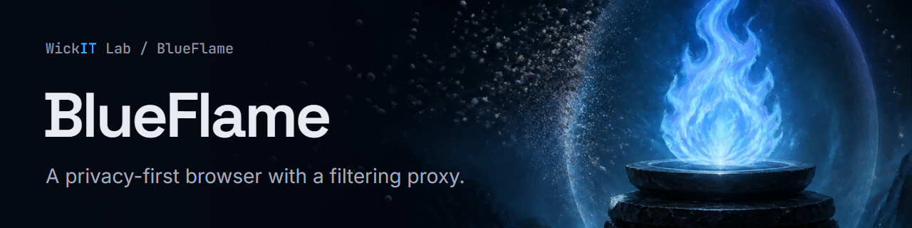

<p align="center">
  
</p>

**Privacy-first browser shell with an embedded filtering proxy and a token-gated control channel for Claude Code.**

BlueFlame is a desktop browser shell that strips trackers and analytics before they reach the page. On desktop an embedded MITM filter proxy intercepts all WebView traffic at the network layer, applies a built-in blocklist plus EasyPrivacy and EasyList, and can route any tab over an embedded Tor client. On Android the same filter rules run through the WebView's native `shouldInterceptRequest` hook, so no proxy and no CA trust step are needed. iOS will follow via `WKContentRuleList` once a Mac is available for the build.

Built with Tauri v2 (Rust), a Preact + Vite frontend and SQLite for local storage. Windows is the primary target (WebView2); Linux builds and runs, with the Windows-only security and Claude features listed under [What's not yet built](#whats-not-yet-built). Everything runs locally and BlueFlame sends no telemetry.

## Contents

- [Tech stack](#tech-stack)
- [Prerequisites](#prerequisites)
- [Getting started](#getting-started)
- [Features (built)](#features-built)
- [Usage](#usage)
- [Claude control channel](#claude-control-channel)
- [Project structure](#project-structure)
- [Security](#security)
- [What's not yet built](#whats-not-yet-built)
- [License](#license)

## Tech stack

| Layer | Technology |
| --- | --- |
| Desktop shell | Tauri v2, Rust 1.95.0 (pinned by `rust-toolchain.toml`) |
| Frontend | Preact 11 (React-compatible), TypeScript, Vite, lucide icons |
| MITM proxy | `hudsucker`, `hyper`, `rustls`, `rcgen` for the root CA |
| Tor | Embedded `arti-client` (default-on `built-in-tor` Cargo feature) |
| Storage | SQLite through `rusqlite` (bundled) |
| Windows integration | `webview2-com` (WebView2 DevTools calls, named pipe, ACLs) |
| Android | Tauri Android project with a `shouldInterceptRequest` WebView client |
| Claude bridge | Node stdio MCP server in `mcp-bridge/` (`@modelcontextprotocol/sdk`) |
| CI | GitHub Actions (frontend, Rust, secret and dependency scan) |

## Prerequisites

- [Rust stable toolchain](https://rustup.rs/) (1.95.0, pinned by `rust-toolchain.toml`)
- [Node.js](https://nodejs.org/) 20+
- [pnpm](https://pnpm.io/installation)
- [Tauri prerequisites](https://v2.tauri.app/start/prerequisites/) for your OS (WebView2 on Windows, `libwebkit2gtk-4.1` on Linux, Xcode tools on macOS)

For Android builds:

- Android Studio (for the SDK and AVD manager)
- JDK 17+
- Android SDK platform-tools, platforms, build-tools 34+, NDK 27+
- Android Rust targets: `rustup target add aarch64-linux-android armv7-linux-androideabi i686-linux-android x86_64-linux-android`
- Env vars: `JAVA_HOME`, `ANDROID_HOME`, `NDK_HOME`

## Getting started

1. Clone and install:

   ```bash
   git clone https://github.com/wickitlab/BlueFlame.git
   cd BlueFlame
   pnpm install
   ```

2. Run in dev mode:

   ```bash
   pnpm tauri dev
   ```

   First launch generates `blueflame-ca.crt` and `blueflame-ca.key` in the app data directory and prompts you to trust the cert so the proxy can intercept HTTPS (see [Trust the CA](#trust-the-ca)).

3. Build a release (output goes to `src-tauri/target/release/`):

   ```bash
   pnpm tauri build
   ```

4. Android (runs on a connected device or emulator; the build produces an APK/AAB under `src-tauri/gen/android/app/build/outputs/`):

   ```bash
   pnpm tauri android dev
   pnpm tauri android build
   ```

   The Android build uses `WebView.shouldInterceptRequest` directly. Filters match the desktop built-in set.

5. Checks (the same ones CI runs):

   ```bash
   pnpm tsc --noEmit
   pnpm build
   cd src-tauri && cargo fmt --check && cargo clippy --all-targets -- -D warnings && cargo test --all
   ```

`pnpm dev` runs the frontend alone against Vite, and `pnpm dev:design` opens a design preview with mocked backends (see [docs/DESIGN_PREVIEW.md](docs/DESIGN_PREVIEW.md)). More background is in [ARCHITECTURE.md](ARCHITECTURE.md), [HOW_IT_WORKS.md](HOW_IT_WORKS.md) and [CONTRIBUTING.md](CONTRIBUTING.md).

## Features (built)

### Privacy and filtering

- **Embedded MITM proxy**: intercepts all WebView traffic locally (HTTP and HTTPS) via the `hudsucker` crate
- **Self-signed root CA**: generated on first run and persisted to the user data dir; the key never leaves disk
- **Built-in blocklist**: covers the worst offenders out of the box (doubleclick, Google Analytics, GTM, hotjar, mixpanel, segment, amplitude, Facebook pixels)
- **Filter list support**: EasyPrivacy and EasyList subscribed by default, EasyList-compatible rules compiled into SQLite, live reload without restart
- **Body analysis and reputation**: request and response analysis hooks plus a URL reputation pass for fingerprinting and tracking heuristics
- **Embedded Tor (via arti)**: SOCKS connector wired through to the proxy so any tab can route over Tor without an external client; the `built-in-tor` Cargo feature is on by default and can be compiled out
- **Private tabs**: sessions isolated from the main store

### Browser shell

- **Tabs and tab switcher**: middle-click a link to open it in a new BlueFlame tab; `Ctrl+T/W/L/F/R/D/Tab/1-9` shortcuts relayed from inside tab webviews
- **Bookmarks**: slash-path folder tree, full-page browser, mobile kebab entry, Netscape `bookmarks.html` import, settings JSON backup and restore
- **Downloads**: saves Content-Disposition attachments, with a list view
- **Themed right-click context menu**: browser-style actions (open, copy link, view source, inspect) on desktop and mobile long-press; suppresses the native menu and routes F12 to the in-app Debug view
- **Find in page**: dedicated `FindBar` component, `Ctrl+F` from any tab
- **Search bar and metasearch**: configurable engines, including Ahmia for `.onion` indexing
- **Resource monitor panel**: ASCII sparklines for CPU, memory and network next to the privacy dashboard
- **New-tab page and branded UI**: gradient logo, lucide icon set across navigation
- **Android chrome**: dedicated mobile UI components, with WebView's native `shouldInterceptRequest` doing the filtering

### Claude control channel

- **Local control pipe**: token-gated Windows named pipe, ACL'd to the current user, no remote-debugging port
- **MCP bridge**: stdio MCP server that Claude Code starts directly; tabs, navigate, read page, click, type, key, scroll, screenshot
- **InPrivate by default**: every tab Claude opens carries none of your logins and is badged in the tab strip
- **Per-origin approval gate**: the first action on a new site asks in the UI and remembers the answer
- **Action log**: every tool call is recorded, viewable in the Debug panel or as JSON lines on disk

### Storage and observability

- **SQLite storage**: history, bookmarks, settings, filter lists and downloads stored locally
- **Privacy dashboard**: live counters for total requests, blocked requests and bytes saved
- **Block log**: per-request view of what the proxy stripped, in real time
- **No telemetry**: BlueFlame itself phones home to nothing; the only network traffic is what you browse plus the filter-list and reputation-feed fetches

## Usage

### Start the proxy

The proxy auto-starts when the app launches and listens on `localhost:18080`. The WebView is configured at startup to route through it. Use the **Enable filters / Disable filters** button in the dashboard to toggle blocking without restarting the proxy.

### Trust the CA

On first run the app creates `blueflame-ca.crt`. Your OS needs to recognise it or HTTPS sites will show certificate warnings. BlueFlame shows a first-run modal offering to handle this for you.

| OS | Auto-install | Manual fallback |
| --- | --- | --- |
| Windows | Yes. The modal runs `certutil -user -addstore Root ...`, which pops a confirmation dialog. No admin required. | Double-click the `.crt` and install it into "Trusted Root Certification Authorities". |
| macOS | Not yet | `sudo security add-trusted-cert -d -r trustRoot -k /Library/Keychains/System.keychain blueflame-ca.crt` |
| Linux | Not yet | `sudo cp blueflame-ca.crt /usr/local/share/ca-certificates/ && sudo update-ca-certificates` |

Installing any root CA is a serious action; see [Security](#security). If you stop using BlueFlame, uninstall the CA from your trust store.

### View stats

The dashboard updates every 2 seconds with totals for requests, blocks and estimated bytes saved.

### Filter lists

BlueFlame ships with EasyPrivacy and EasyList subscribed by default. On first launch it:

1. Compiles the built-in minimal rule set into the active filter immediately, so the proxy blocks the worst offenders even offline.
2. Loads any cached filter list bodies from `<app_data>/filter-cache/` and hot-swaps the merged set in.
3. Fetches fresh copies of each list in the background, writes them to the cache, and swaps again.

Failures (bad HTTP, malformed lines, invalid regex) are logged and skipped, so a single bad list line does not break filtering. Invoke the `refresh_filter_lists` Tauri command to re-download on demand; it returns `{ lists_ok, lists_failed, patterns_active }`.

## Claude control channel

BlueFlame runs a local control server so Claude Code can drive it the way it drives Chrome: open a tab, read the page, click, type. It is Windows-only for now, and `SECURITY.md` spells out exactly what the channel can and cannot reach.

How it works:

- On launch, BlueFlame writes a random per-session token to `<app_data>/control/token` and opens a Windows named pipe at `\\.\pipe\blueflame-control`. Both the pipe and the token file carry an ACL restricted to the current Windows user. The pipe refuses any connection whose first message does not carry a byte-for-byte match of that token.
- `mcp-bridge/` is a stdio MCP server that Claude Code starts as a subprocess. It reads the token file and speaks newline-delimited JSON to the pipe. It never opens a network port itself.
- Every tab Claude opens is InPrivate (no cookies, storage or logins from your regular browsing) and shows a `C` badge in the tab strip. The first tool call against a new origin blocks until you answer an in-app prompt (Allow or Deny); the answer is remembered for the rest of that origin's lifetime. Every call is appended to `<app_data>/control/action-log.jsonl`, and the last 50 show up in the Debug view.
- Page actions (`get_page_text`, `read_page`, `find`, `click`, `type`, `key`, `scroll`, `screenshot`) run in-process against the tab's own WebView2 instance via `ICoreWebView2::CallDevToolsProtocolMethod`, the same DevTools Protocol that Chrome DevTools uses, called directly rather than over a remote-debugging port. BlueFlame never opens one.

Add the bridge to Claude Code yourself; nothing here edits your Claude config:

```bash
cd mcp-bridge
pnpm install
claude mcp add --transport stdio blueflame -- node "$(pwd)/index.mjs"
```

Start BlueFlame first: the bridge reads its token file at startup and exits if BlueFlame has not written one yet.

Testing: `cargo test --all` in `src-tauri` covers the token, the approval gate and tool dispatch on every platform. On Windows there is also an OS-level end-to-end test, not part of the default run, that spawns a real named pipe and the real `mcp-bridge` process (run `pnpm install` in `mcp-bridge/` first):

```bash
cd src-tauri
cargo test --all -- --ignored real_pipe_end_to_end_through_the_bridge
```

That test proves the pipe, its ACL, the token handshake and the bridge's MCP protocol work together. It does not open a real WebView2 tab, so the final check is a manual smoke test: add the bridge, start BlueFlame, and ask Claude to open, read, click and type on a real page.

## Project structure

```text
BlueFlame/
  src/                  Preact + Vite frontend: tab strip, URL bar, dashboard,
                        block log, bookmarks, downloads, settings, mobile chrome
  src-tauri/            Rust Tauri backend
    src/
      proxy.rs          hudsucker MITM proxy, stats, filtering
      ca.rs, ca_trust.rs, trust.rs   Root CA generation and OS trust install
      filter_parser.rs, list_loader.rs   EasyList parser and remote list fetcher
      body_analysis.rs, reputation.rs    Request/response heuristics, URL reputation
      embedded_tor.rs, socks_connector.rs   Arti-backed Tor SOCKS proxy
      storage.rs        SQLite (history, bookmarks, settings, filter lists, downloads)
      control/          Claude control channel (token, approval gate, action log,
                        dispatch, Windows-only named pipe and DevTools calls)
    gen/android/        Android Studio and Gradle project
  mcp-bridge/           Stdio MCP server bridging Claude Code to the control pipe
  docs/                 Design preview, design audit, password locker design
  scripts/              Design-token drift check, build guards, screenshot script
  public/               Static assets served by Vite
  assets/               README banner, logo, social preview and icons
  .github/workflows/    CI (frontend and Rust jobs) and the security scan
```

## Security

BlueFlame is a local-only application with no telemetry, analytics or remote configuration channel. See [SECURITY.md](SECURITY.md) for the threat model, hardening measures and how to report a vulnerability (support@wickitlab.com).

- **Root CA key**: installing any root CA is a serious action. Anyone who gets the CA private key could impersonate HTTPS sites on that machine. BlueFlame keeps the key locally in the app data dir alongside the cert, as a plain file today; moving it into the TPM is on the roadmap.
- **Claude control channel**: tabs are InPrivate, each new origin needs your approval, and every action is logged. Page content returned to Claude is untrusted data, so treat it as data and not instructions.
- **Filter coverage**: rules carrying `$options` and exception rules (`@@`) are skipped rather than risk overblocking, which trades coverage for fewer false positives.
- BlueFlame is not a hardened anonymity browser and is not Tor Browser.

## What's not yet built

From [ROADMAP.md](ROADMAP.md), where the maintainer owns the order. BlueFlame is on the path to v1.0.0 as a daily-driver browser.

- CA private key in the TPM (it is a plain PEM file today), then a built-in password locker (the design is in [docs/password-locker.md](docs/password-locker.md))
- Default-browser registration on Windows, multiple windows, a signed update mechanism, Opera GX bookmark and history import, and a Windows build with a signed installer in CI (CI builds on Linux only today)
- Claude control channel phase 2: a one-click Claude desktop extension for the bridge
- A usability and accessibility pass across every screen
- macOS and Linux CA auto-install, and Linux parity for the CA key protection, the Claude control channel, tab events and the password locker
- A proxy bypass list for sites that reject intercepted certificates
- Later: filter exception rules and the most common `$options`, Settings buttons for list refresh, signed APK/DMG/AppImage installers, the iOS shell, FTS5 history search, Tor circuit details in the UI and CA rotation

## License

This project is dual-licensed:

- [AGPL v3](LICENSE) - free for open-source use. Derivatives and SaaS deployments must release their source under AGPL.
- [Commercial license](COMMERCIAL.md) - for proprietary or closed-source use, or hosted services that do not want to comply with AGPL source-disclosure requirements. Contact support@wickitlab.com for terms.
